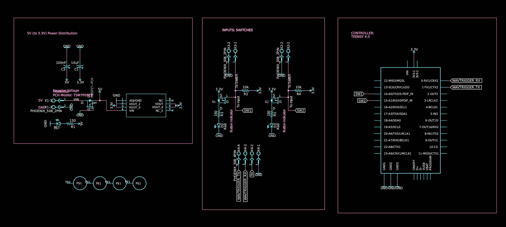
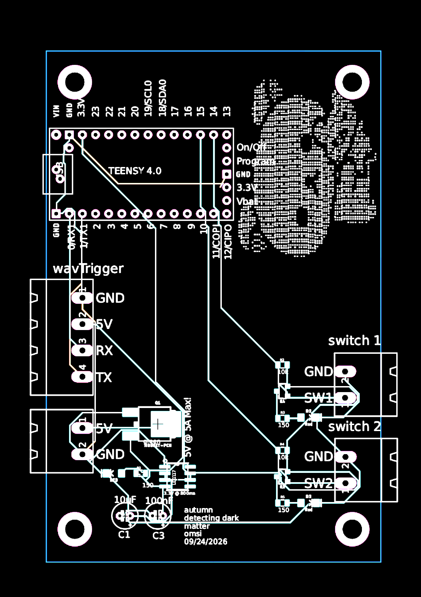

# Detecting Dark Matter for Physics Lab 





## Summary of interactives
The `detecting dark matter` project demonstrates a physics simulation by comparing two cylindrical forces of motion each with differing porportions of mass. 

Two interactive pieces are rolled down individual ramp tracks (lanes).

## Objective of interactives
Two switches are located at the bottom of each ramp, one per lane. Each lane has its own sound, played by a `wavTrigger` when that lane's switch is triggered. There is no first or second place: lane 1 (switch 1) always plays track 1, and lane 2 (switch 2) always plays track 2.

Once a switch is triggered, its sound plays once and that switch locks out. Holding the switch down does not replay the sound.

Releasing a switch does not unlock it. The lock-out only clears once **both** switches are untriggered and have stayed that way for 1s, after which both lanes can trigger again. The two lanes can sound at the same time (poly play).

## Firmware behavior notes
- Switches are debounced (20ms).
- A switch that is already pressed at power-up stays locked out until both switches are released and the 1s reset delay passes.
- The Teensy's built-in LED flashes briefly (100ms) whenever a sound is triggered.
- Debug output is printed over USB serial at 115200 baud.

## Checkpoints 

1. Trigger two switches, firmware identifying which switch was triggered
2. Output a sound for each switch via `Wavtrigger` (2x .wav files stored in SD-card) to amp to external speaker
3. Build logic for a reset cycle

# Hardware Assembly

## Summary of components

1. Custom circuit board with parts:
```
    a) Teensy 4.0 
    b) (X1) Terminal for 5V (to 3.3V for Teensy)
    c) (X2) Terminal for Switch #2 (custom switch circuit) to Teensy Pin 15
    d) (X3) Terminal for Switch #1 (custom switch circuit) to Teensy Pin 14
    e) (X4) Terminal for WavTrigger input to Teensy Pins 0 & 1 (TX & RX)
```

2. Parts:

**Switches:** [V-154-1C25](https://www.digikey.com/en/products/detail/omron-electronics-inc-emc-div/V-154-1C25/1829023)

Firmware reads each switch with the Teensy's internal pull-up, so a pressed switch must pull the pin to ground (active-low). If the switch circuit is wired the opposite way, flip `SWITCH_ACTIVE_LOW` in `main.cpp`.

**WAV Trigger:** connected to `Serial1` (Teensy pin 0 = RX1, pin 1 = TX1) at 57600 baud (the WAV Trigger default).

**Microcontroller:** [Teensy 4.0](https://www.pjrc.com/store/teensy40.html)


# Assets 
Audio files go on the WAV Trigger's SD card. The WAV Trigger identifies tracks by the leading number in the file name, so the names must start with `001_` and `002_`:

1. Lane 1 sound (switch 1, pin 14, track 1): `001_lane1.wav`
2. Lane 2 sound (switch 2, pin 15, track 2): `002_lane2.wav`

Only the leading number matters to the WAV Trigger, so the rest of each file name is free to change.

Files must be WAV format (the WAV Trigger does not play MP3).
